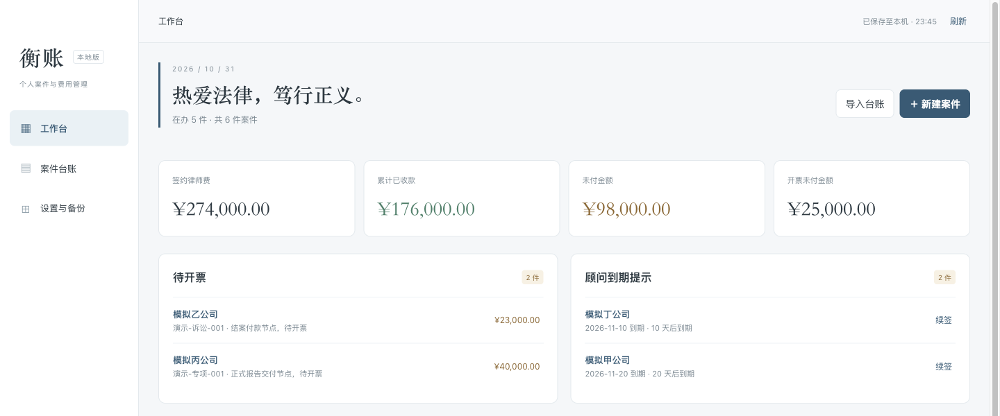
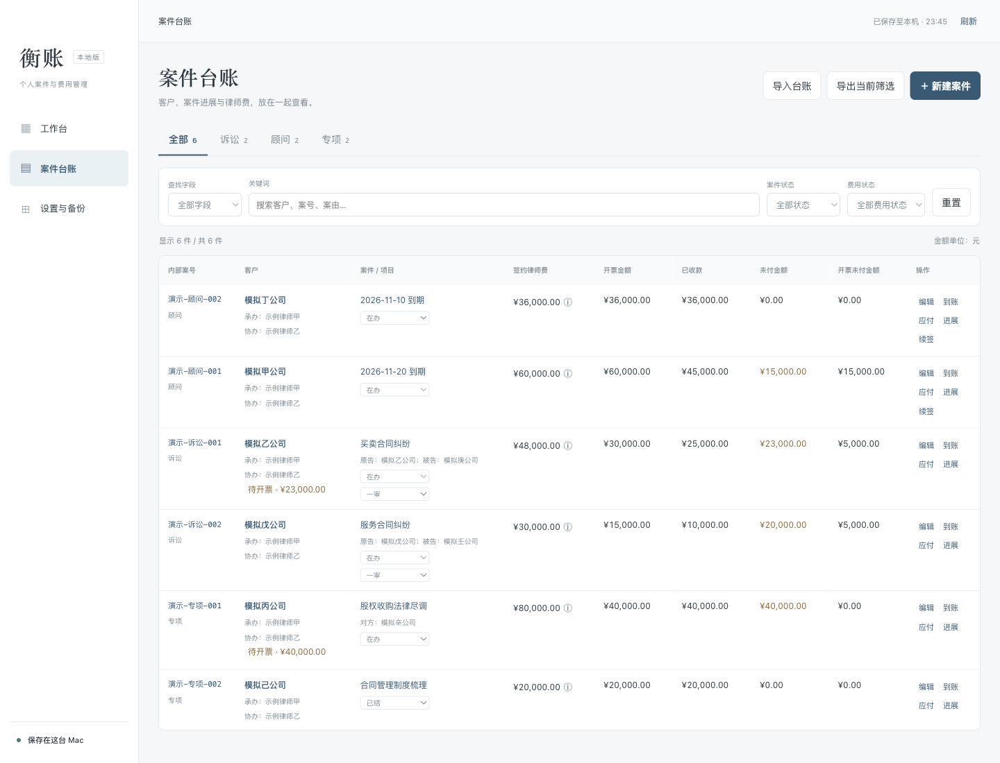
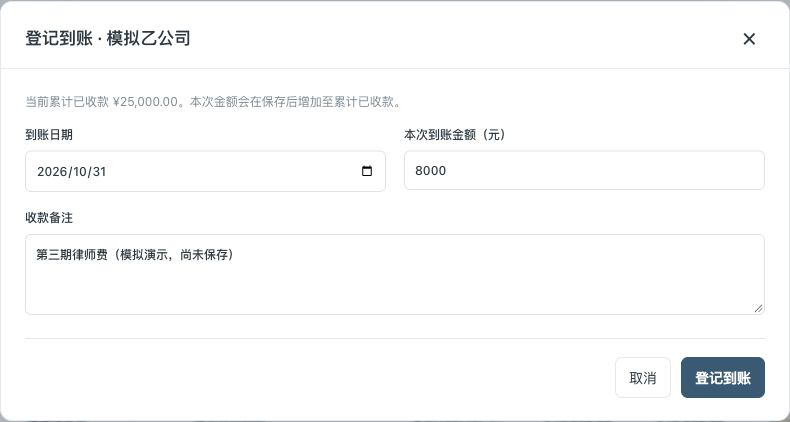
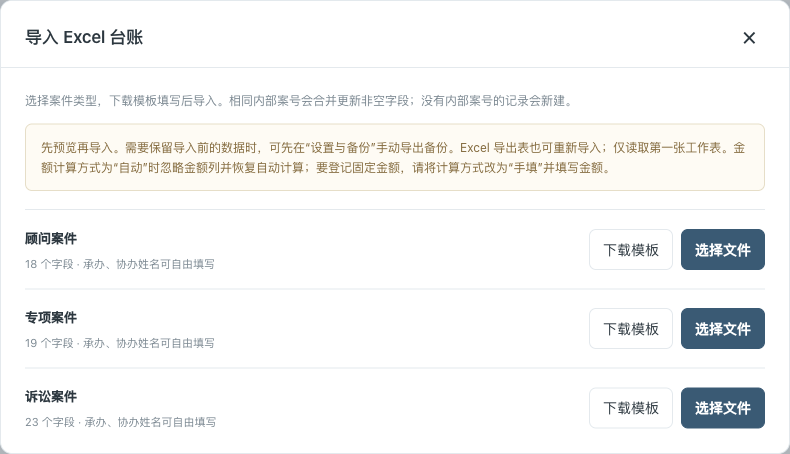
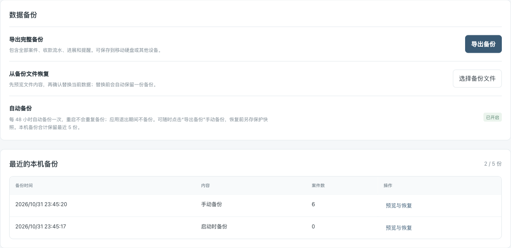

# 衡账｜给律师用的律师费管理应用

**衡账是一款给律师个人使用的律师费用管理应用。** 每个案件约定收多少、开票多少、到账多少、还有多少未付，都能集中查看。

律师费分几次收、发票分几次开，案子一多，核对起来就费时间。我开发衡账，希望让同行少花些时间翻台账，把每笔费用记清楚。

**当前为 1.0.8 单机版，支持 Mac。** 数据保存在自己的电脑，日常记账可以离线完成，存储、备份和恢复由自己掌握。

## 能做什么

- **收费约定**：按诉讼、法律顾问、专项案件登记客户和律师费。
- **开票与到账**：登记开票金额、逐笔记录到账，汇总查看，在工作台掌握整体费用情况，标记待开票事项。
- **案件节点**：记录案件进展，记下完成立案、一审判决书出具等重要事项。
- **顾问续签**：查看顾问到期提示，创建续签案件。
- **导入导出与备份**：支持 Excel 台账导入、导出，每 48 小时自动备份，保留最近 5 份本机备份，支持完整备份与恢复。
- **工作台格言**：可在“设置与备份”中自定义，也可恢复默认。

## 看看实际界面

以下截图来自 Mac 单机版，客户、案号、案件和金额均为模拟数据。

### 工作台：先看费用，再看待办

签约律师费、累计已收款、未付金额和开票未付金额集中显示；下方列出待开票事项、顾问到期提示和按业务类型汇总的费用，打开应用就能查看。

### 案件台账：一张表核对每个案件的费用

诉讼、顾问和专项案件放在同一张台账里，可按类型、状态、费用情况筛选，也可搜索客户、案号或案由。右侧可直接编辑、登记到账、标记待开票和记录进展；顾问案件还可续签。

### 登记到账：只填这次收到的钱

点击“到账”，填写本次金额、到账日期和备注。示例中累计已收款为 25,000 元，本次填写 8,000 元；保存后累计已收款变为 33,000 元，并留下一笔收款流水，便于以后核对。

### Excel 导入：沿用已有台账

点击“导入台账”，按诉讼、顾问或专项下载对应模板，填好后选择文件。系统先预览新增、合并和校验结果，确认后再写入；相同内部案号合并非空字段，没有案号的记录新建。

### 设置与备份：保存完整记录，换电脑也能恢复

“导出备份”保存全部案件、收款流水、进展、提醒和格言设置；“选择备份文件”先预览，再确认恢复。应用运行期间每 48 小时自动备份，本机合计保留最近 5 份，也可从列表中预览与恢复。

## 常用按钮怎么用

| 按钮或入口 | 用途 |
| --- | --- |
| **＋ 新建案件** | 选择诉讼、顾问或专项，登记客户、收费约定及案件信息。 |
| **案号、客户或案件名称** | 点击台账中的文字打开案件详情，查看费用、收款流水和进展。 |
| **编辑** | 修改案件信息、累计开票金额和收费约定；未付金额、开票未付金额可自动计算或手填。 |
| **到账** | 增加一笔实际收款，填写本次金额，保存后累加至已收款；不要填成累计金额。 |
| **应付** | 标记或查看待开票提醒，记录付款节点、金额和说明；完成提醒不会自动增加开票或到账金额。 |
| **进展** | 记录立案、开庭、判决、交付等节点，保留可回看的进展记录。 |
| **续签** | 仅用于顾问案件，创建独立的新一期案件，继承客户与服务约定，费用和流水重新开始记录。 |
| **导入台账／下载模板** | 下载对应业务模板，选择 Excel 文件，预览并确认导入。 |
| **导出当前筛选／导出全部台账** | 前者只导出筛选结果，后者导出全部案件；按业务类型分工作表。 |
| **导出备份** | 保存包含全部案件及历史记录的完整 JSON 备份，可另存到其他设备。 |
| **选择备份文件／预览与恢复** | 从外部备份或本机快照预览内容，确认后整体替换当前数据，恢复前先保留保护快照。 |
| **检查更新** | 手动检查新版，查看说明并前往 GitHub 下载；检查版本时不上传案件数据。 |
| **保存格言／恢复默认** | 自定义工作台首页文字，或恢复“热爱法律，笃行正义。”。 |

从一件案件开始，可以依次完成：**新建案件 → 登记收费与开票金额 → 每次收款点“到账” → 重要节点点“进展” → 导出备份**。Excel 导出用于台账交换，完整历史记录请用 JSON 备份保存。

## 源码与使用许可

衡账免费提供，[项目源代码](https://github.com/pansong-law/hengzhang-open)公开，可按自己的需要修改、增加功能，也可据此开发联网版本。

采用 **MIT 许可协议＋Commons Clause 附加条款 1.0**：允许使用、修改和分享，包括律师、律所日常业务使用；不得售卖本软件，或收费提供主要价值来自本软件功能的产品或服务。分享或发布时须保留版权声明和许可条款，具体以[许可全文](https://github.com/pansong-law/hengzhang-open/blob/main/LICENSE)为准。

## 下载与安装

不妨先从一个案件开始，把收费约定、开票和到账记下来，看看是否顺手。欢迎同行试用，也欢迎告诉我哪些地方还不好用。

打开[安装包下载页](https://github.com/pansong-law/hengzhang-open/releases/latest)，下载通用版 DMG，双击打开，将“衡账.app”拖入“应用程序”。支持 macOS 13 及以上，兼容 苹果芯片和英特尔芯片的 Mac，应用自带运行环境。

## 首次打开的来源验证提示

衡账当前使用本地临时签名（ad-hoc），Apple Developer ID 签名和公证尚待完成。首次从 GitHub 下载后，Mac 可能提示“无法验证开发者”或“Apple 无法检查是否包含恶意软件”。确认安装包来自本项目发布页后，可按以下步骤打开：

1. 将“衡账.app”拖入“应用程序”，先双击打开一次。
2. 出现来源验证提示时，点击“完成”或“取消”，保留应用。
3. 打开苹果菜单 →“系统设置”→“隐私与安全性”。
4. 在安全性区域找到“衡账”被阻止的提示，点击“仍要打开”。
5. 按系统要求通过 触控 ID（Touch ID）或 Mac 登录密码确认，再点击“打开”。

如果没有“仍要打开”入口，或操作后仍无法启动，可将完整提示发给开发者协助处理。提示“已损坏”时，先重新下载安装包并核对发布页的 SHA-256；提示明确检测到恶意软件或“会损坏电脑”时，联系开发者核查。

## 更新与备份

应用首次启用自动检查时检查新版本，此后每 48 小时自动检查一次，也可在“设置与备份”中手动检查。下载新版后，退出衡账并替换应用。案件和费用数据保存在独立目录；更新前建议导出完整备份，并另存一份到其他设备。

1.0.8 使用新的更新仓库地址。使用早期版本的用户，可从安装包下载页手动安装一次 1.0.8，以继续接收新版提醒。

**开发者：潘松律师**

个人主页：https://aifalv.vip/
